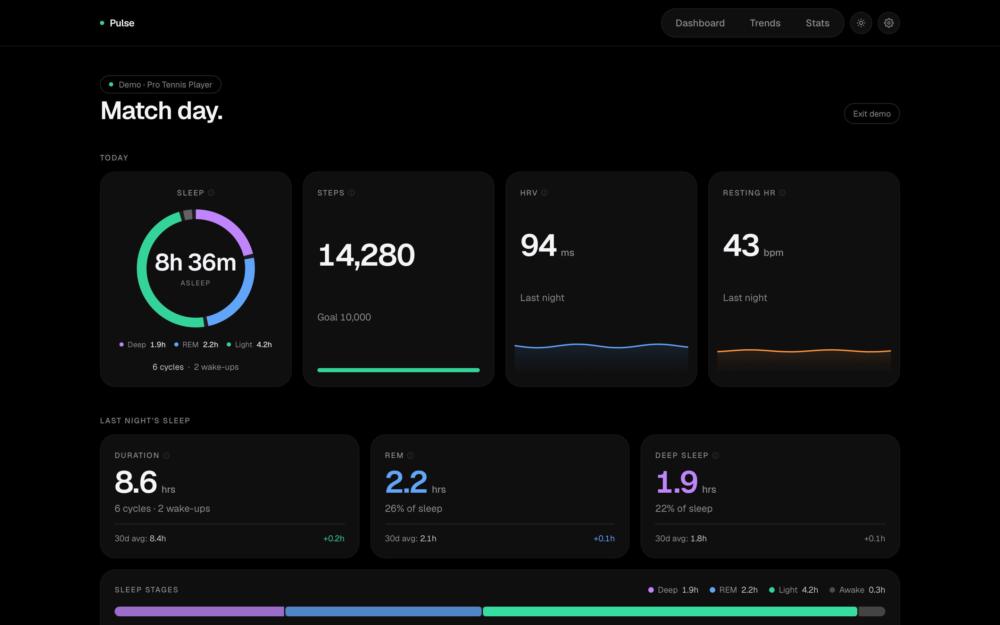
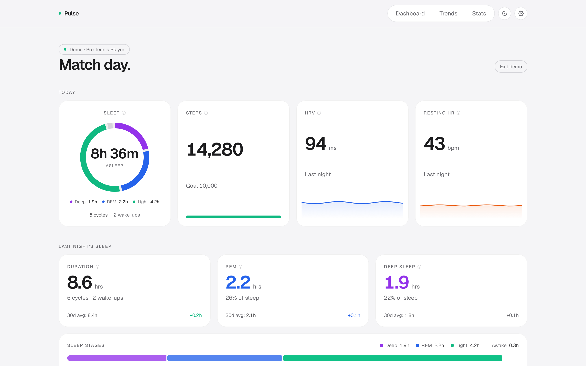
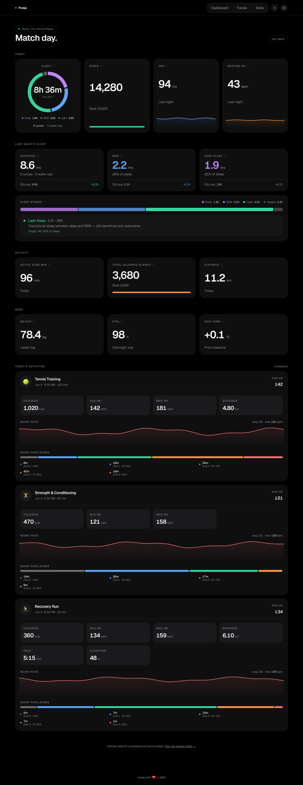
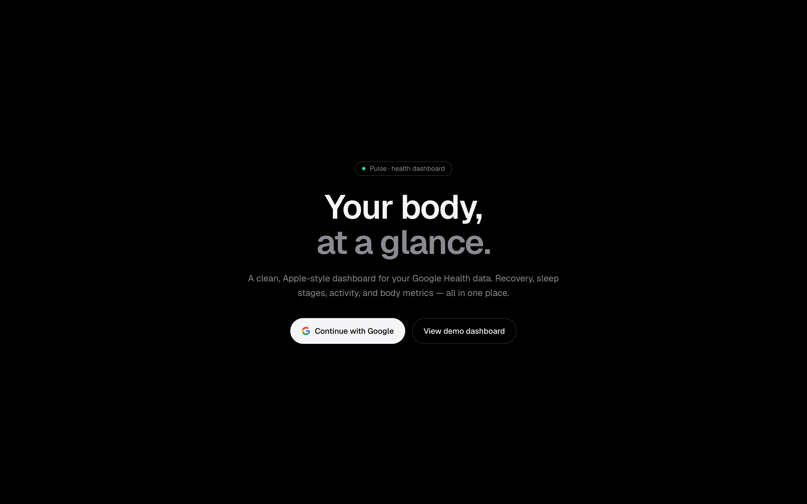
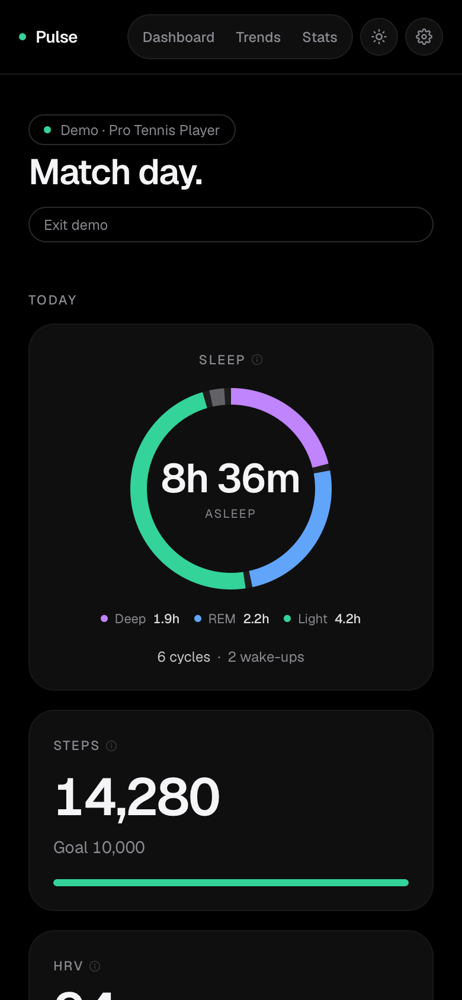

# Pulse

A clean, Apple-style dashboard for your Google Health data. Sleep, heart, activity and body stats, all on one page instead of five apps.



<sub>Those are demo numbers from a made-up pro tennis player. Mine are not this good.</sub>

---

## What's in it

- **Dashboard** — today at a glance: HRV, resting heart rate, sleep (duration, REM, deep, plus a stages breakdown), steps, active zone minutes, calories, distance, weight, SpO₂ and skin temp, then each workout with its heart rate and zones. Flick back through any previous day too.
- **Trends** — HRV, resting HR, sleep, steps, calories and more, charted over weeks and months.
- **Stats** — the big numbers. Total hours slept, total steps, peak HRV, 10k step days, longest sleep streak, best week, your workouts, and how many marathons your walking adds up to. Filter by all time, 90, 30 or 7 days.
- **Settings** — step, calorie and sleep goals, km or miles, kg or lbs, light or dark, and a button to pull your full history from Google.

Hover the ⓘ on a tile to see what it means and where the number comes from.

### About the scores
Google doesn't give you Whoop-style recovery or sleep quality scores, so Pulse works them out itself from your HRV, resting heart rate, sleep and heart-rate zones, scored against your own 30-day baseline. The formulas are written out in plain English in [`lib/score.ts`](lib/score.ts). No hidden maths.

---

## Screenshots

**Light mode, if that's your thing**



**The whole dashboard**: sleep, activity, body, then every workout with heart rate and zones



**The front door**



**On your phone**



---

## Run it yourself

It's Next.js 16, Tailwind v4, Framer Motion and Recharts, with Supabase for sign-in and storage.

```bash
npm install
npm run dev
# open http://localhost:3000
```

The demo at [localhost:3000/demo](http://localhost:3000/demo) works straight away, no setup. For your own data you'll need the following.

### 1. Supabase
- Make a project at supabase.com.
- Run [`supabase/schema.sql`](supabase/schema.sql) in the SQL editor.
- Put these in `.env.local`:
  ```
  NEXT_PUBLIC_SUPABASE_URL=https://YOUR-PROJECT.supabase.co
  NEXT_PUBLIC_SUPABASE_ANON_KEY=...
  SUPABASE_SERVICE_ROLE_KEY=...
  ```

### 2. Google Cloud
- Turn on the **Google Health API** (`health.googleapis.com`).
- Set the OAuth consent screen to **Testing** and add yourself under **Test users**.
- Create an **OAuth 2.0 Client ID** (Web application) with this redirect URI: `https://YOUR-PROJECT.supabase.co/auth/v1/callback`, and add `http://localhost:3000` under **Authorised JavaScript origins**.
- On the **Data Access** page, add the read-only scopes listed in `GOOGLE_HEALTH_SCOPES` in [`lib/env.ts`](lib/env.ts).
- Add the client ID and secret to `.env.local` too, so Pulse can refresh your token:
  ```
  GOOGLE_CLIENT_ID=...
  GOOGLE_CLIENT_SECRET=...
  ```

### 3. Supabase → Google
Authentication → Providers → **Google**. Switch it on and paste in the client ID and secret.

---

## How it hangs together

- `app/page.tsx` — the landing page and "Continue with Google"
- `app/auth/callback/route.ts` — finishes the sign-in
- `app/api/dashboard/route.ts` — serves a day's numbers from the Supabase cache, or fetches them from Google and saves them
- `app/api/backfill/route.ts` — pulls your old history in chunks
- `lib/google-health.ts` — talks to the Google Health API
- `proxy.ts` — keeps you signed in (Next.js 16 renamed middleware to proxy)

---

## Known quirks

- In Testing mode, Google's refresh tokens die after 7 days, so you'll need to sign in again about once a week. Fine for personal use. Anything more needs Google to verify the app.
- Google hasn't fully documented the field names for HRV and resting heart rate yet. Pulse makes its best guess and shows nothing rather than making numbers up.
